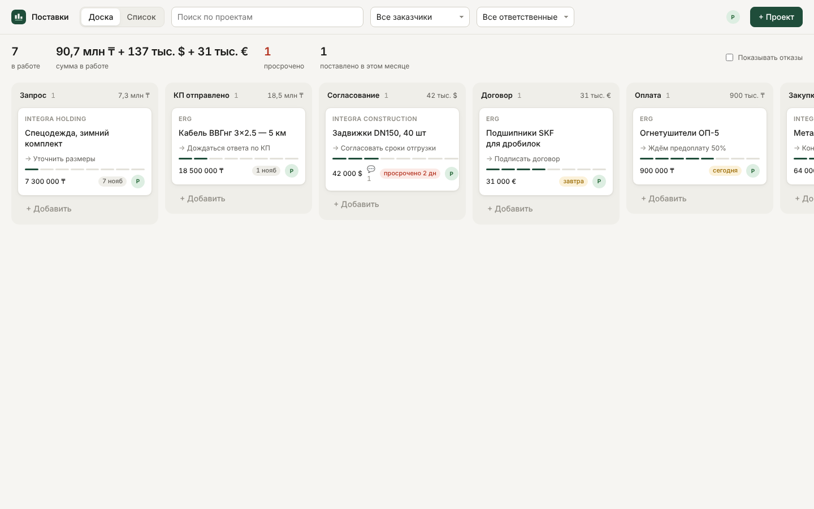
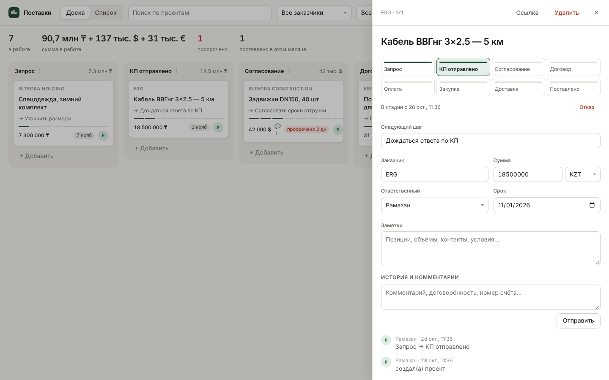
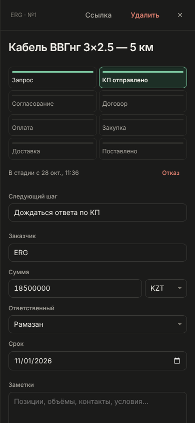

# Поставки — трекер проектов

Минималистичная платформа для отслеживания проектов поставок материалов заказчикам: ERG, Integra Holding, Integra Construction и другим. Все проекты в одном месте. У каждого видно стадию, сумму, срок, ответственного и следующий шаг. Рамазан, Расул и остальная команда работают на одном сервере и видят изменения друг друга.



## Что умеет

- **Доска по стадиям поставки**: Запрос → КП отправлено → Согласование → Договор → Оплата → Закупка → Доставка → Поставлено (плюс «Отказ»). Карточку можно перетащить мышью или передвинуть кнопкой в карточке проекта.
- **Список**: та же информация таблицей, с сортировкой по любой колонке.
- **Сводка сверху**: сколько проектов в работе, общая сумма (по валютам: ₸, $, €, ₽, ¥), сколько просрочено, сколько поставлено за месяц.
- **Фильтры**: по заказчику, ответственному и полнотекстовый поиск.
- **Карточка проекта**: все поля редактируются на месте и сохраняются сами. Есть история изменений (кто и когда сдвинул стадию) и комментарии.
- **Ссылка на проект**: кнопка «Ссылка» копирует адрес, который можно отправить Расулу.
- **Команда**: администратор добавляет людей (логин и пароль) и задаёт права.
- **Телефон и тёмная тема** работают без настройки. Приложение можно «установить» на главный экран.
- **Горячие клавиши**: `N` — новый проект, `/` — поиск, `Esc` — закрыть карточку.

<p>
  
  
</p>

## Запуск локально

Нужен Node.js 22.5 или новее. Внешних зависимостей нет: база — встроенный в Node SQLite.

```bash
npm start
```

Откройте http://localhost:3000. При первом входе создаётся аккаунт администратора. Расула и остальных добавьте через иконку аккаунта → «Команда» → «Добавить человека».

## Запуск на сервере (чтобы Расул видел)

Подойдёт любой VPS (Hoster.kz, PS.kz, Hetzner, DigitalOcean) с Docker.

1. Направьте домен (например, `tracker.вашдомен.kz`) A-записью на IP сервера.
2. Склонируйте репозиторий на сервер и впишите свой домен в `Caddyfile`.
3. Запустите:

```bash
docker compose up -d --build
```

Caddy сам получит HTTPS-сертификат. Через минуту сайт откроется по `https://ваш-домен`.

Если домена нет и нужно просто по IP: в `docker-compose.yml` уберите сервис `caddy`, у `app` замените `expose` на `ports: ["3000:3000"]` и поставьте `COOKIE_SECURE: "0"`. Адрес будет `http://IP:3000`. Без HTTPS пароли идут по сети в открытом виде, поэтому для постоянной работы лучше с доменом.

### Резервная копия

Все данные хранятся в одном файле `data/tracker.db`. Копию можно сделать на ходу:

```bash
sqlite3 data/tracker.db ".backup data/backup-$(date +%F).db"
```

## Настройки (переменные окружения)

| Переменная | По умолчанию | Что делает |
| --- | --- | --- |
| `PORT` | `3000` | Порт сервера |
| `HOST` | `0.0.0.0` | Адрес, на котором слушает сервер |
| `DB_PATH` | `data/tracker.db` | Путь к файлу базы |
| `COOKIE_SECURE` | выкл. | `1` — cookie только по HTTPS (включено в docker-compose) |

## Устройство

- `server.js` — HTTP API, авторизация (scrypt-хеши паролей, сессии в HttpOnly-cookie, ограничение попыток входа), SQLite.
- `public/` — интерфейс на чистом JS/CSS без сборки.
- `test/` — тесты API: `npm test`.

Стадии и валюты задаются в начале `server.js` (`STAGES`, `CURRENCIES`). Список заказчиков для подсказок — там же (`DEFAULT_CLIENTS`). Новые заказчики добавляются автоматически, как только появляются в проектах.

## ECC

В `.claude/settings.json` подключён плагин [ECC](https://github.com/affaan-m/ECC) (`ecc@ecc`): его навыки, агенты и хуки будут доступны Claude Code в этом репозитории. Интерфейс собран по его навыкам `frontend-design-direction` и `make-interfaces-feel-better`.
